# How our solution works: the visual, easy version

This guide explains our Hash Code 2017 "Streaming Videos" solution with pictures and plain
words. Each section starts with **one sentence**, then a figure, then a few simple steps.
The technical details (code lines, cost) are folded away under *"For the curious"*; you don't
need them to understand the idea.

The full measurements are in [PIPELINE.md](PIPELINE.md). The first Python version is
described in [SOLUTION.md](SOLUTION.md).

## The whole thing in 30 seconds

> **Picture fridges and a supermarket.** People (*endpoints*) want snacks (*videos*). The
> supermarket (*data center*) has everything but is far away. Small fridges (*caches*) sit
> close to some groups of people, but each fridge has limited space. A person takes the snack
> from the closest fridge that has it, otherwise from the supermarket. **Our job: decide what
> goes in each fridge so people wait as little as possible.**

We do it in layers. Each layer starts from the previous answer and only keeps a change that
does not make the score worse:

1. **Greedy.** Fill fridges quickly, best value per MB first.
2. **Re-pack.** Take one fridge and re-fill it *perfectly*, while the others stay as they are.
3. **LNS.** Take two fridges near each other, empty both, and re-fill them together.
4. **Exact solver.** When the data set is small, compute the *proven best* answer outright.

## Words used in this guide

| Word | Meaning in simple terms |
|---|---|
| cache | a small, fast storage server (a fridge) with a size limit in MB |
| endpoint | a group of users. It's linked to some caches, and always to the data center |
| latency | waiting time in milliseconds. Lower is better |
| request group | "endpoint e wants video v, n times" (lines for the same pair are added up) |
| saving | how many ms we save compared with going to the data center |
| knapsack | "pick items of different sizes to fit a bag and get the most value" |
| heap | a to-do list that always hands you the best item first |
| DP (dynamic programming) | solving a big question by filling a table of small answers |
| stuck / local optimum | no single small change helps, yet a better answer exists |
| MILP | writing the whole problem as equations and letting a solver find the best answer |
| annealing | a search that sometimes accepts a worse step, to escape being stuck |

**Colour key, the same in every figure**

| Colour | Means |
|---|---|
| blue | a cache server |
| orange | an endpoint (a group of users) |
| violet | stage 1, greedy |
| aqua | stage 2, exact re-pack |
| pink | stage 3, Large Neighbourhood Search |
| yellow | stage 4, exact solver |
| gray | the last commit |
| green / red | kept / dropped |

Contents:
1. [The problem](#1-the-problem)
2. [The whole pipeline](#2-the-whole-pipeline)
3. [What the code remembers](#3-what-the-code-remembers)
4. [Stage 1: greedy](#4-stage-1-greedy)
5. [Why the greedy is not enough](#5-why-the-greedy-is-not-enough)
6. [Stage 2: perfect re-pack of one cache](#6-stage-2-perfect-re-pack-of-one-cache)
7. [Stage 3: LNS, re-fill two caches together](#7-stage-3-lns-re-fill-two-caches-together)
8. [Stage 4: exact solver](#8-stage-4-exact-solver-small-data-sets-only)
9. [What each stage is worth](#9-what-each-stage-is-worth)
10. [Summary](#10-summary)
11. [What the last commit changed](#11-what-the-last-commit-changed)

---

## 1. The problem

**In one sentence:** choose which videos to copy into which caches, without overfilling any
cache, so that requests are served as fast as possible.

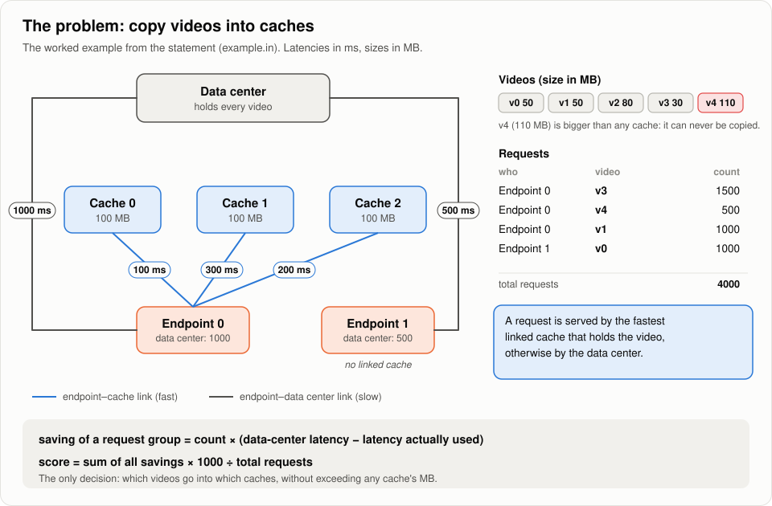

- **Caching = copying a video into a cache server.** This is our only decision.
- Endpoint 0 can reach cache 0 in 100 ms, cache 2 in 200 ms, cache 1 in 300 ms, or the data
  center in 1000 ms. It always uses the fastest one that **has** the video.
- Endpoint 1 has no cache, so we can never help it.
- **Why it is hard:**
  - Each cache is a packing puzzle (sizes vs space).
  - The caches affect each other. Once endpoint 0 gets v3 from cache 0, a second copy of v3
    in cache 2 helps nobody.

## 2. The whole pipeline

**In one sentence:** run the fast improving solver, and on small data sets also the exact
solver, at the same time, then keep whichever answer scores best.

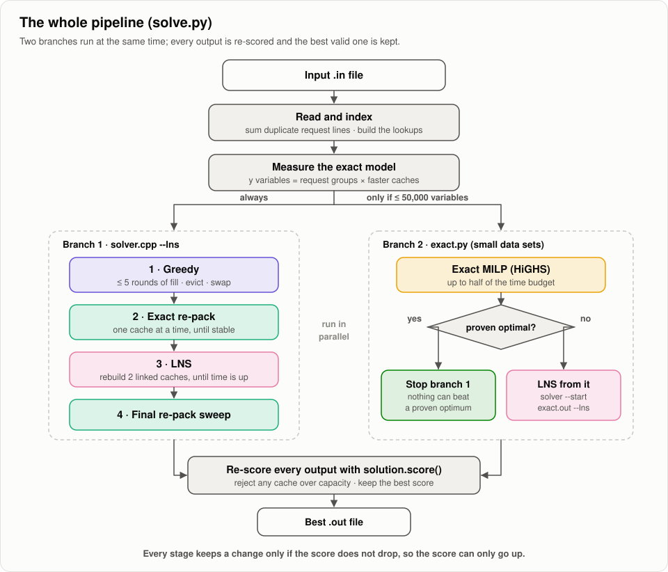

1. Read the file and add up duplicate request lines.
2. Measure how big the exact model would be.
3. **Always** run branch 1: greedy, then re-pack, then LNS.
4. **If the model is small** (≤ 50,000 variables), also run the exact solver.
   - If it proves the best answer, stop everything.
   - If it runs out of time, improve its answer with LNS.
5. Re-score every answer, check that no cache is overfilled, and keep the best.

<details><summary>For the curious</summary>

- Everything above is [solve.py](solve.py).
- Branch 1 is one C++ binary, [solver.cpp](solver.cpp), run with `--lns`.
- With `--time-limit`, the first greedy round always finishes, so there is always a valid
  answer to write.

</details>

## 3. What the code remembers

**In one sentence:** for every request, the code remembers how fast it is served *right now*,
so it can tell at once how much a new copy would really help.

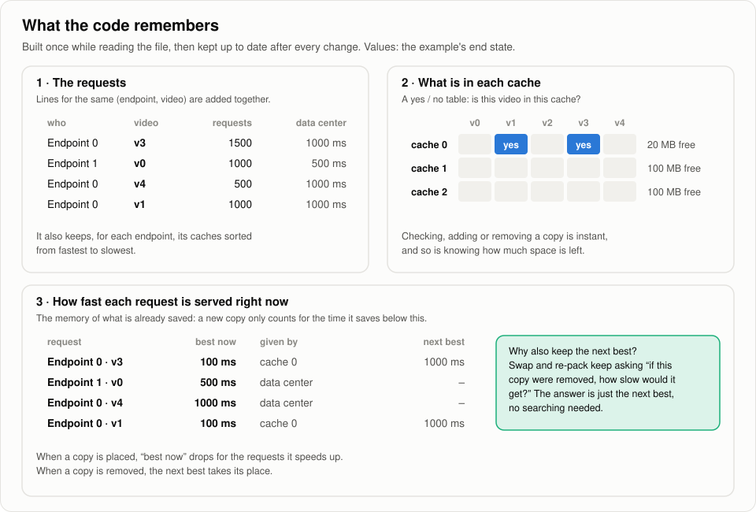

- **Panel 1:** the requests, grouped by (endpoint, video).
- **Panel 2:** a yes/no table "is video v in cache c?", plus how many MB each cache has left.
- **Panel 3, the key idea:** for each request, the best latency it currently gets. A new copy
  only earns the part *below* that number. This is how the code avoids paying twice for the
  same video.

<details><summary>For the curious: code locations</summary>

| Structure | Where | Why it exists |
|---|---|---|
| request groups `rE / rV / rN` | [solver.cpp:36](solver.cpp#L36) | the solver works on groups, not raw lines |
| `epCaches[e]`, sorted fastest first | [solver.cpp:95](solver.cpp#L95) | the first holder found is the one actually used |
| `Placement` (`P`, `list`, `pos`, `rem`) | [solver.cpp:120](solver.cpp#L120) | "is this video in this cache?", the list of a cache's videos, adding or removing, free space: all instant |
| `cur[r]` (greedy) | [solver.cpp:206](solver.cpp#L206) | how fast each request is served right now |
| `b1 / b1c / b2` (re-pack, LNS) | [solver.cpp:404](solver.cpp#L404) | best time, which cache gives it, and the next best: answers "how slow without this copy?" instantly |

</details>

## 4. Stage 1: greedy

**In one sentence:** keep placing the copy that saves the most time per MB, re-checking its
value just before placing it, then clean up useless copies and make good trades.

### One round

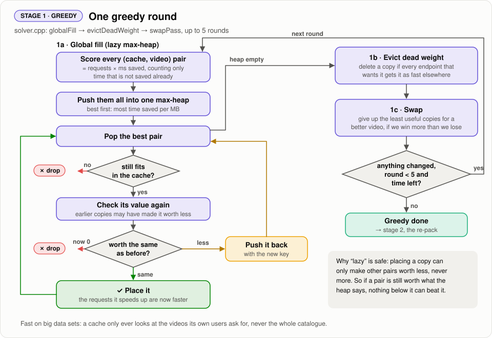

1. Work out, for every (cache, video) pair, how much time it would save per MB.
2. Put all pairs in a **to-do list sorted best-first** (the heap).
3. Take the best pair and check it again, because something placed earlier may have made it
   worth less:
   - **Still worth the same:** place it.
   - **Worth less now:** put it back in the list with its new value.
   - **Worth nothing, or no longer fits:** throw it away.
4. When the list is empty:
   - **Evict:** remove copies that became useless.
   - **Swap:** trade cheap copies for a better video.
5. Repeat, up to 5 rounds, or stop earlier when a round changes nothing.

### The same thing on the example, step by step

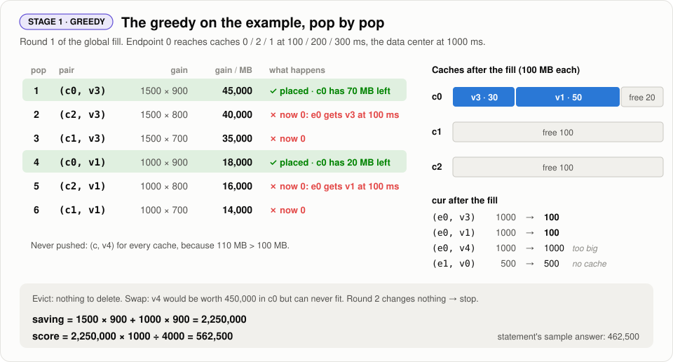

- Step 1 puts v3 in cache 0. Now endpoint 0 already gets v3 at 100 ms, so v3 in cache 2 or
  cache 1 is worth **0**. Steps 2 and 3 throw those pairs away.
- The final score is **562,500**, better than the statement's own sample answer (462,500).

### Clean-up 1: evict (throw away copies nobody uses)

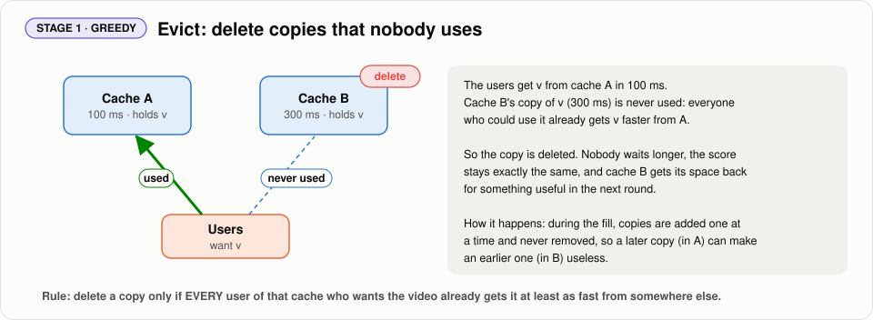

During the fill, copies are only ever added, never taken out. So a copy placed early can
become useless later. In the picture, cache B got a copy of v first. Later, cache A, which
is faster for the same users, also got v. From then on nobody uses B's copy.

Evict finds such copies and deletes them. The score doesn't change, because nobody was using
them. But the space they took is now free, and the next round can fill it with something
useful.

### Clean-up 2: swap (trade weak copies for a better video)

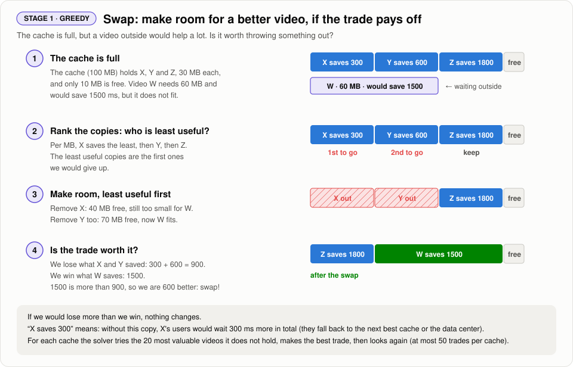

Imagine a full suitcase, and you find something more useful that does not fit. You ask: *if
I take out the least useful things, is the new item worth more than what I took out?*

That is exactly what swap does for each cache:

1. **Find a video that is not in the cache but would help a lot.** Here, W would save 1500
   ms, but it needs 60 MB and only 10 MB is free.
2. **Rank the copies already inside, from least useful to most useful.** Usefulness is
   counted per MB, because we are trying to free space.
   - A copy's usefulness is how much longer its users would wait without it. They would fall
     back to the next best cache, or to the data center.
   - Here X is the least useful, then Y, then Z.
3. **Take out the least useful ones, one by one, until W fits.**
   - Removing X frees 40 MB, which is still not enough.
   - Removing Y as well frees 70 MB, which is enough.
4. **Compare what we lose with what we win.**
   - We lose what X and Y were saving: 900 in total.
   - We win what W saves: 1500.
   - We come out 600 ahead, so the trade is made. If we would lose more than we win, nothing
     changes.

The solver tries this with the 20 most promising outside videos and keeps the best trade.
Then it looks again, up to 50 trades per cache.

<details><summary>For the curious: code and cost</summary>

- Fill: [`globalFill`, solver.cpp:261](solver.cpp#L261). Evict:
  [solver.cpp:312](solver.cpp#L312). Swap: [solver.cpp:330](solver.cpp#L330).
- A cache only looks at videos its own endpoints ask for, never the whole catalogue. That
  keeps a round fast even on `kittens` (13 s in C++).

</details>

## 5. Why the greedy is not enough

**In one sentence:** "best value per MB first" is a good habit, but it can leave space unused
that a different combination would fill better.

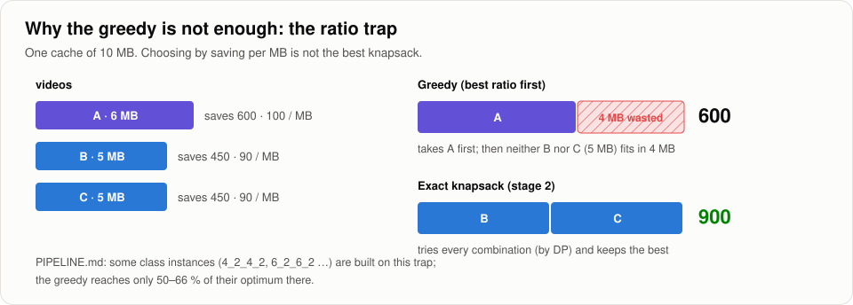

Some class data sets are built exactly around this trap. On them the greedy gets only
50–66 % of the best score.

## 6. Stage 2: perfect re-pack of one cache

**In one sentence:** take one cache, imagine emptying it, and refill it with the best possible
set of videos, while all the other caches stay as they are. Then do the same for the next
cache.

**Why we need it.** The greedy (stage 1) fills a cache one video at a time and never thinks
about combinations. As section 5 shows, it can pick one big video that blocks two smaller
ones that would be better together. Re-pack fixes that: for each cache, it looks for the best
*combination*.

It works in three parts.

### Part 1: how useful is each video in this cache?

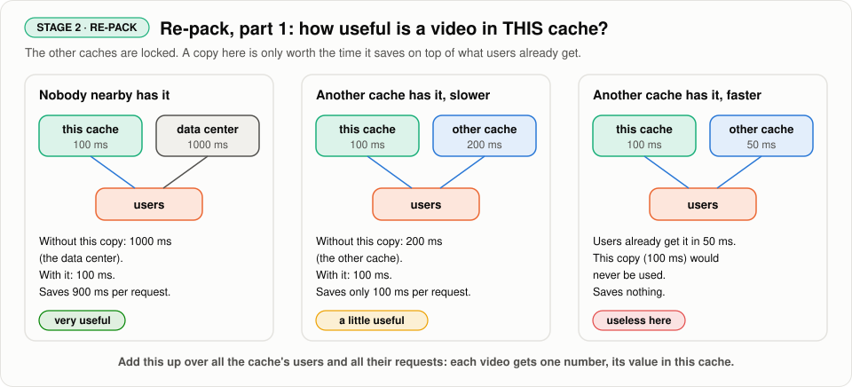

First we **lock all the other caches**: they will not change while we work on this one. Then,
for every video that this cache's users ask for, we ask: *if this cache had a copy, how much
time would it save?*

The answer depends on what the users can already get somewhere else:

- **Nobody nearby has the video.** Without this copy, users go all the way to the data center.
  The copy saves a lot.
- **Another cache has it, but slower.** Users already get it from there. This copy only saves
  the difference.
- **Another cache has it, faster.** Users would never use this copy. It saves nothing here.

We add this up over all the cache's users and all their requests. In the end every video has
**one number: how much it is worth in this cache**. Because the other caches are locked, these
numbers don't change while we decide.

### Part 2: refill the cache with the best combination

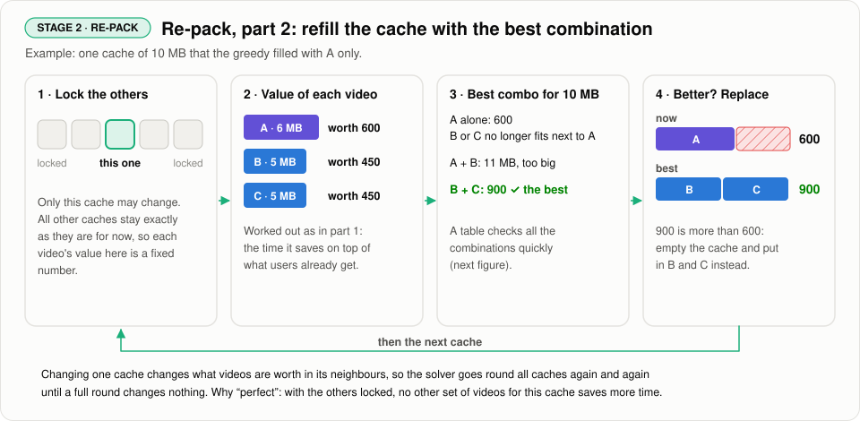

Now it's a plain packing puzzle: a box of 10 MB, items with a size and a value, and the goal
of putting in the most value.

- The greedy took **A** (6 MB, worth 600). After that, neither B nor C fits in the 4 MB left.
- The best combination is **B + C** (5 + 5 MB, worth 900).
- 900 is more than 600, so the cache is emptied and refilled with B and C.

Then we move to the next cache. Changing one cache changes what videos are worth in its
neighbours, so the solver goes round all caches again and again until a full round changes
nothing.

It's called **perfect** because, with the other caches locked, no other choice of videos for
this cache would save more time.

### Part 3: the table that finds the best combination

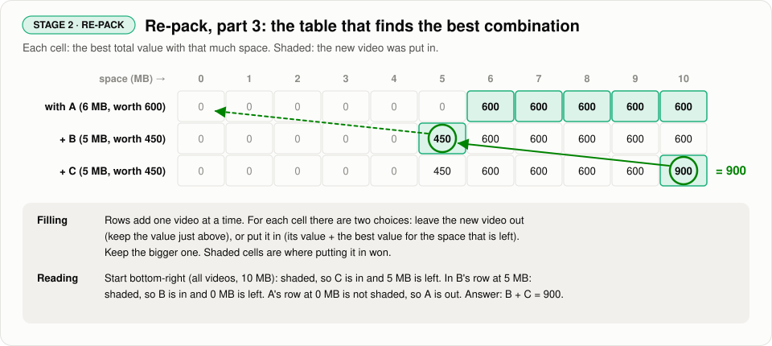

Trying every combination by hand would take far too long when there are hundreds of videos.
Instead, the solver fills a table.

- **One row per video, one column per amount of space.** Each cell holds the best value you
  can get with that much space, using the videos of the rows so far.
- **Each cell is a small choice:** leave the new video out, or put it in and fill the space
  that is left as well as the row above says you can. Keep whichever is worth more.
- **To read the answer,** start at the bottom-right cell and follow the shaded cells back up.
  They tell you which videos were put in. Here that gives B and C, worth 900.

<details><summary>For the curious: code and cost</summary>

- [`repack`, solver.cpp:489](solver.cpp#L489) and
  [`knapsack`, solver.cpp:450](solver.cpp#L450).
- To stay fast, each cache only considers its most promising videos (about 500), plus the ones
  it already holds.
- The work for one cache grows with the number of videos it considers times the size of the
  cache.
- Re-pack also covers evict and swap inside one cache: those are just two of the fillings the
  table considers.
- Starting from the greedy's answer ends higher than starting from empty caches
  (videos: 610,505 vs 606,631).

</details>

## 7. Stage 3: LNS, re-fill two caches together

**In one sentence:** pick two caches that share users, empty both, re-fill them together, and
keep the result only if the score did not drop.

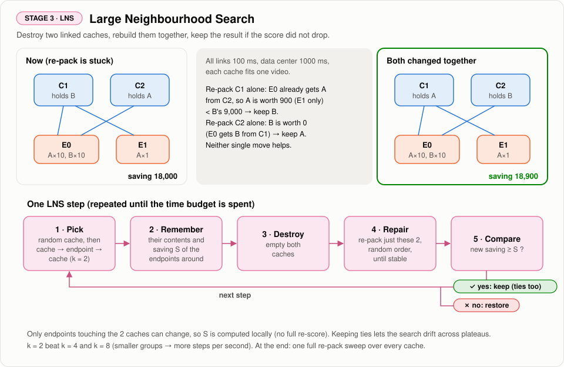

- **Why we need it (top of the figure):**
  - Re-packing C1 alone doesn't help, because E0 already gets A from C2.
  - Re-packing C2 alone doesn't help either, because E0 already gets B from C1.
  - Only changing **both at once** finds the better answer: 18,900 instead of 18,000.
- **One step (bottom of the figure):** pick, remember, empty, re-fill, compare. Repeat until
  the time is up.
- A result that is **equally good** is also kept. This lets the search wander across flat
  areas instead of stopping at the first one.

<details><summary>For the curious</summary>

- [`lns`, solver.cpp:578](solver.cpp#L578).
- Only the endpoints around the two caches can change, so the score check is local and
  cheap.
- Two caches per step worked better than 4 or 8, because smaller steps mean more steps per
  second.

</details>

## 8. Stage 4: exact solver (small data sets only)

**In one sentence:** write the whole problem as equations and let a solver (HiGHS) find the
**proven** best answer, which is only possible when the problem is small.

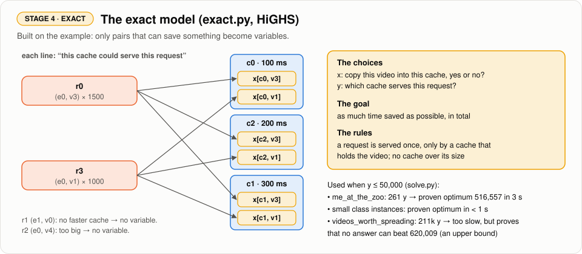

- **x** = "this video is in this cache". **y** = "this request is served by this cache".
- We only create the variables that could save time. Requests with no faster cache, and videos
  that are too big, get none.
- On large data sets it does not finish, but it still tells us **the best score anyone could
  possibly get**, so we know how much is left to win.

## 9. What each stage is worth

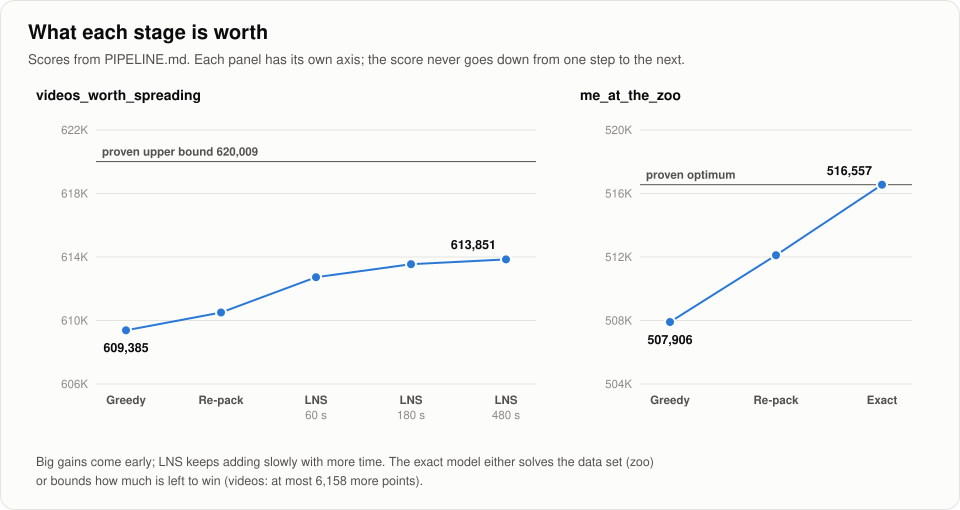

The greedy gets most of the way. Each later stage adds a little more. On a small data set the
exact solver goes all the way to the proven best answer.

## 10. Summary

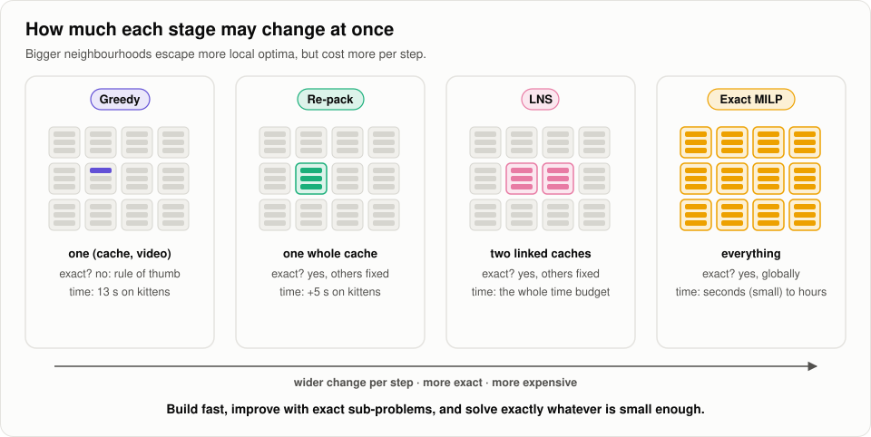

| Stage | Changes at once | Perfect? | Can lower the score? | Fixes |
|---|---|---|---|---|
| Greedy | one copy | no | no | builds a good start fast |
| Evict / swap | a few copies | no | no | useless copies, some bad choices |
| Re-pack | one whole cache | yes, if the others stay fixed | no | bad combinations inside a cache |
| LNS | two caches | yes, if the others stay fixed | no | changes that need two caches at once |
| Exact | everything | yes | — | small data sets: the proven best answer |

---

## 11. What the last commit changed

The last commit on `main` is the merge **`10b114f`** (pull request #10), which brought in
**`d4abaea` "Add swap/replace annealing to the solver and local contest results"**. It made
**one change that is always on** and **two that are optional**.

### Change 1 (always on): a much faster packing table

**In one sentence:** if all video sizes are multiples of the same number, count space in
blocks of that size instead of single MB. The table gets much smaller and the answer is the
same.

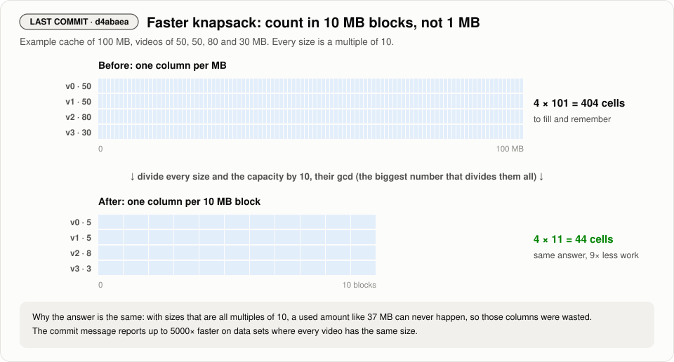

- Before building the table, the code finds the **gcd**: the biggest number that divides every
  video size and the capacity.
- If the gcd is bigger than 1, it divides everything by it and solves the smaller puzzle.
- **Why this makes the whole pipeline better:**
  - The re-pack and every LNS step use this table, so each step gets faster.
  - With the same time budget, LNS can try more steps, which can lead to a better score.
  - The commit message reports up to **5000× faster** on data sets where every video has the
    same size.

<details><summary>For the curious</summary>

The new lines are at the top of `knapsack`
([solver.cpp:459](solver.cpp#L459)). They find the biggest number that divides every video size
(that fits) and the capacity. If that number is bigger than 1, they divide everything by it and
solve the smaller puzzle.

</details>

### Changes 2 and 3 (optional, off by default): allow steps backwards

**In one sentence:** let the search sometimes accept a slightly worse answer, which helps it
escape being stuck, and add very cheap one-video moves to search with.

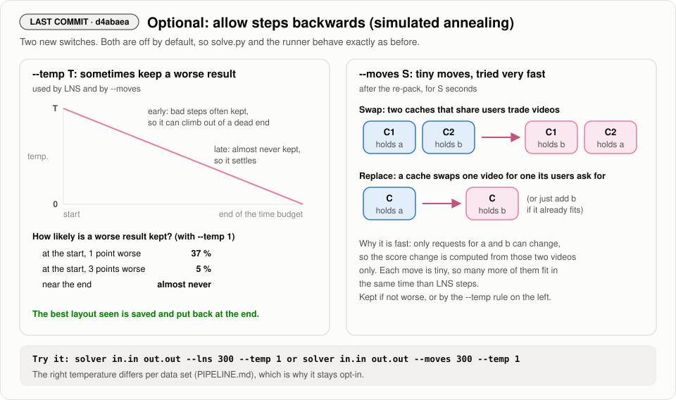

- **`--temp T`:** LNS (and `--moves`) may keep a worse result.
  - The chance is high at the start and drops to zero by the end (the "temperature" cools
    down).
  - The best answer seen is saved and put back at the end, so the final result is never worse
    than the best one found.
- **`--moves S`:** for S seconds, try tiny moves:
  - **swap** two videos between caches that share users, or
  - **replace** one video in a cache by one its users ask for.

  Only the requests for those two videos can change, so checking a move is very fast.
- **Why it is optional:** earlier tests ([PIPELINE.md §3](PIPELINE.md#why-lns-and-not-simulated-annealing))
  showed that annealing can win on one data set (videos: 615,635 vs 613,548 with LNS), but
  only with a temperature tuned for that data set. LNS alone gained more in total. So
  [solve.py](solve.py) and the runner still use plain LNS, and these switches are there to
  try per data set:

  ```bash
  solver in.in out.out --lns 300 --temp 1
  solver in.in out.out --moves 300 --temp 1
  ```

<details><summary>For the curious</summary>

- `--temp` acceptance in `lns`: [solver.cpp:629](solver.cpp#L629). The more points a result
  loses, the less likely it is kept. The temperature starts at the `--temp` value and falls
  steadily to 0 by the end of the run, so worse results are kept less and less often.
- `moves`: [solver.cpp:653](solver.cpp#L653). The score change of a move is measured on the
  requests of the two videos involved only.

</details>

### Results included in the commit

The commit also adds our group's local contest submissions:

| File | Total score |
|---|--:|
| `instances/local_contest/results/instances_D.zip` (first version) | 22,867,444 |
| `instances/local_contest/results/instances_D_v2.zip` (improved) | **22,875,014** (+7,570) |

The commit does not say which settings produced v2. Comparing the two zips, 8 of the 15
output files changed (instances 02, 04, 05, 08, 10, 11, 12 and 14).

---

*The figures are generated by [docs/pipeline/make_diagrams.py](docs/pipeline/make_diagrams.py).
Edit it and run `python docs/pipeline/make_diagrams.py` to rebuild them.*
